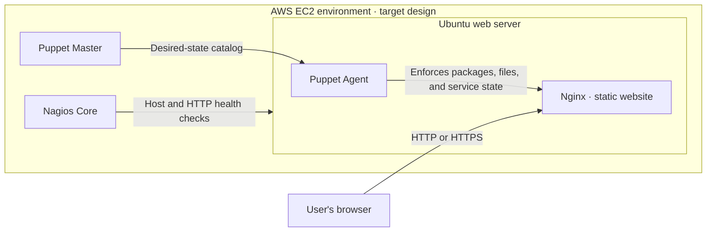

<div align="center">

# CloudOps Monitor

### Automated Web Server Deployment &amp; Continuous Monitoring

An interactive, responsive project showcase for a cloud-hosted web server workflow using **AWS EC2**, **Puppet**, **Nginx**, and **Nagios Core**.

[](#run-locally)
[](#technology)
[](#deploy-with-nginx)

[Explore the architecture](#architecture) · [Run locally](#run-locally) · [Deploy with Nginx](#deploy-with-nginx)

</div>

---

## Important: demo scope

This repository contains a **static front-end showcase** of the CloudOps Monitor project. The dashboard, host and service states, metrics, timestamps, and check output are illustrative examples—not live monitoring data. **“Simulate Drift & Heal” only animates sample states in the browser.**

The page does not connect to AWS, Puppet, Nagios, or any backend. This repository does not include Puppet manifests, Nagios configuration, cloud provisioning code, credentials, or a running server. The architecture and workflow describe the intended system design; they should not be read as proof of a deployed environment.

## What this project demonstrates

- Declarative server configuration and repeatable deployment with Puppet.
- Static website delivery from Nginx on an Ubuntu-based AWS EC2 instance.
- A monitoring design for host availability, HTTP checks, and service health with Nagios Core.
- A failure-detection and recovery workflow: detect drift, reconcile desired state, and verify service recovery.
- A dependency-free, responsive portfolio interface built with semantic HTML, CSS, and vanilla JavaScript.

## Architecture

The diagram describes the **logical target architecture**. The exact EC2 instance layout depends on how the infrastructure is deployed.



In the intended workflow, Puppet keeps the web node aligned with its declared configuration. Nagios independently checks availability and can report a failure; a subsequent Puppet run can reconcile the service back to its desired state. The dashboard on this site is only a visual explanation of that workflow.

## Technology

| Area | Technology | Role |
| --- | --- | --- |
| Cloud compute | AWS EC2 | Target environment for the server workflow |
| Operating system | Ubuntu Server 22.04 LTS | Example Linux host for the project |
| Configuration management | Puppet | Declares and enforces server state |
| Web server | Nginx | Serves the static website |
| Monitoring | Nagios Core | Intended host and service health checks |
| Website | HTML5, CSS3, vanilla JavaScript | Builds the responsive project showcase |

The website itself has no framework, package manager, build process, API, or runtime dependency.

## Run locally

Clone the repository, then open `index.html` directly in a modern browser:

```bash
git clone https://github.com/ruthwik-thotapelli/CloudOps-Monitor-Automated-Web-Server-Deployment-Monitoring.git
cd CloudOps-Monitor-Automated-Web-Server-Deployment-Monitoring
```

Open the file using your operating system:

```powershell
# Windows PowerShell
Start-Process .\index.html
```

```bash
# macOS
open index.html

# Linux
xdg-open index.html
```

No installation or internet connection is needed to view the site. Its fonts, icons, and visual effects use system fonts, inline SVG, and local CSS.

## Deploy with Nginx

On an Ubuntu server where Nginx is installed, copy the three website files into the default web root:

```bash
sudo apt update
sudo apt install -y nginx
sudo install -d -m 0755 /var/www/html
sudo install -m 0644 index.html style.css script.js /var/www/html/
sudo nginx -t
sudo systemctl enable --now nginx
```

Open the server address in a browser after allowing inbound HTTP traffic on TCP port **80** in the host firewall and, if applicable, the EC2 security group. Restrict SSH (TCP port **22**) to trusted source addresses; do not expose it broadly. The commands above use Nginx's default site and do not configure HTTPS. For an internet-facing deployment, configure a domain and TLS before collecting credentials or serving sensitive content.

To update an existing copy, run the `install` command again with the new files, then validate the Nginx configuration and reload Nginx:

```bash
sudo nginx -t && sudo systemctl reload nginx
```

## Explore the showcase

- **Architecture:** follow the EC2, Puppet, Nginx, and Nagios flow.
- **Workflow:** select a phase to view an illustrative deployment/configuration example. The phase selector supports keyboard navigation.
- **Dashboard preview:** use **Simulate Drift & Heal** to play through a browser-only example outage and recovery. No real host is contacted or changed.
- **Mobile navigation:** open the menu from the compact header on narrow screens.

## Project files

```text
.
├── index.html   # Semantic page content and inline SVG illustrations
├── style.css    # Responsive layout, visual styling, and reduced-motion support
├── script.js    # Mobile menu, workflow tabs, scroll reveals, and demo simulation
└── README.md    # Project overview and usage instructions
```

## Development and verification

Edit the three website files directly and refresh `index.html` in the browser. There is no build or test runner. If Node.js is available, the JavaScript syntax can be checked with:

```bash
node --check script.js
```

The dashboard's simulated statuses are UI examples, not a substitute for validating an actual Puppet deployment, Nginx endpoint, or Nagios check.

## Security notes

- Never put AWS keys, SSH private keys, passwords, or other secrets in this static site or its Git history.
- Treat the dashboard as public presentation content; it is not an authenticated monitoring console.
- Apply least-privilege network rules and configure HTTPS before using a public deployment for anything beyond a demo.
- No license is included in this repository. Add one explicitly before granting reuse rights.
