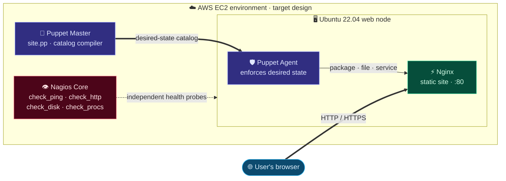
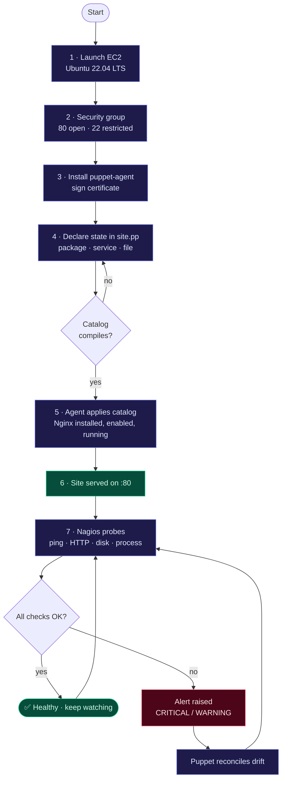
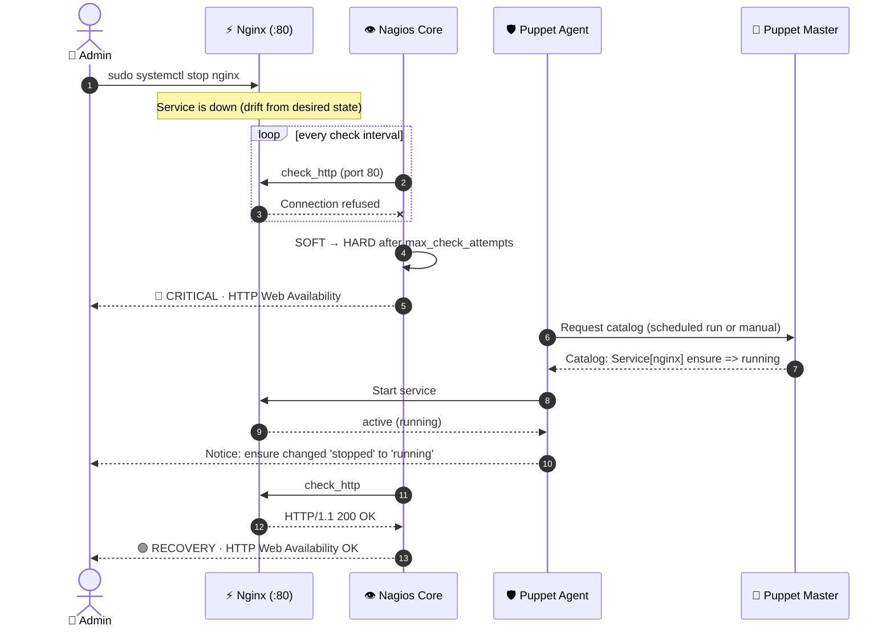
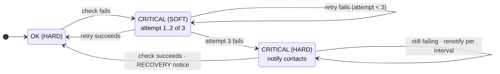
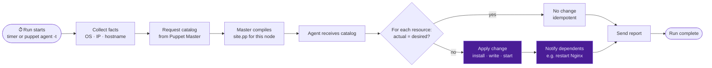
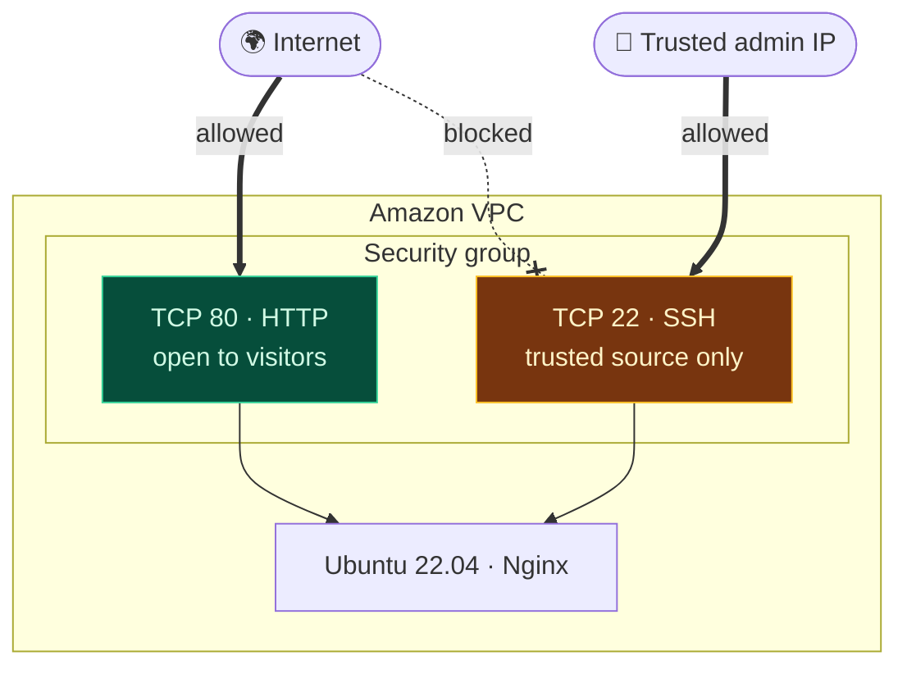
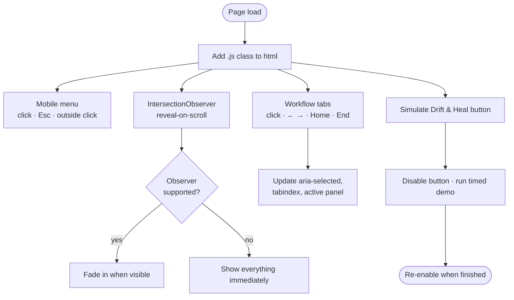

<div align="center">


### Automated Web Server Deployment &amp; Continuous Monitoring
**AWS EC2 · Puppet · Nginx · Nagios Core**

*A dark-glass, zero-dependency interactive showcase of a declarative deploy, detect, and self-heal DevOps loop.*

<br/>

[](#-run-it-in-10-seconds)
[](#-tech-stack)
[](#-deploy-on-nginx)
[](#-tech-stack)
[](#-ui-interaction-flow)

[**Architecture**](#-architecture) · [**Flows**](#-flow-gallery) · [**Self-heal**](#-the-self-healing-loop) · [**Run**](#-run-it-in-10-seconds) · [**Deploy**](#-deploy-on-nginx) · [**Viva runbook**](#-live-demo-runbook)

</div>

---

> [!IMPORTANT]
> **Honest scope.** This repository is a **static front-end showcase** of the CloudOps Monitor design. Every host state, metric, timestamp and check output on the dashboard is **illustrative sample data**. *Simulate Drift & Heal* only animates states in your browser. The repo contains **no** Puppet manifests, Nagios config, provisioning code, credentials, or running server, and the diagrams describe the **target design**, not proof of a live deployment.

---

## ⚡ At a glance

| | |
|---|---|
| 🎯 **Goal** | Replace manual server administration with declared state and independent health verification |
| 🧱 **Stack** | AWS EC2 · Ubuntu 22.04 LTS · Puppet · Nginx · Nagios Core |
| 🔁 **Core idea** | *Puppet declares → Nginx serves → Nagios watches → Puppet heals → Nagios confirms* |
| 🖥️ **Showcase** | 7 sections · animated topology · tabbed workflow · mock Nagios console |
| 📦 **Footprint** | 3 files (`index.html`, `style.css`, `script.js`), no framework, no npm, no build |

---

## 🧭 Flow gallery

Every diagram below renders natively on GitHub (Mermaid). Jump to the one you need:

| # | Diagram | What it answers |
|---|---|---|
| 1 | [System architecture](#-architecture) | What are the components and who talks to whom? |
| 2 | [Delivery pipeline](#-end-to-end-delivery-pipeline) | How does a change reach a visitor? |
| 3 | [Self-healing loop](#-the-self-healing-loop) | What happens when Nginx dies? |
| 4 | [Nagios state machine](#-nagios-alert-state-machine) | How does a check go OK → CRITICAL HARD → OK? |
| 5 | [Puppet run lifecycle](#-puppet-agent-run-lifecycle) | What does one convergence run do? |
| 6 | [Network &amp; security](#-network--security-boundaries) | Which ports and trust boundaries exist? |
| 7 | [UI interaction flow](#-ui-interaction-flow) | How does the showcase page behave? |
| 8 | [Demo timeline](#-demo-simulation-timeline) | What does the browser simulation animate, and when? |

---

## 🏗 Architecture

> Logical **target design**. Exact EC2 layout depends on how the infrastructure is deployed.



**Design principle:** the *thing that fixes* (Puppet) and the *thing that watches* (Nagios) are deliberately **independent**. A watchdog that shares fate with the service it watches is not a watchdog.

---

## 🚚 End-to-end delivery pipeline



---

## 🩹 The self-healing loop

The signature scenario of the project: **break Nginx on purpose, watch the system recover.**



> Recovery time depends on the agent's run interval (Puppet's default is 30 minutes) unless you trigger a run manually with `puppet agent -t`, as the runbook below does.

---

## 🚦 Nagios alert state machine



Parameters used in the showcase config snippet: `check_interval 1` · `retry_interval 1` · `max_check_attempts 3` · `notification_interval 30`.

---

## 🔄 Puppet agent run lifecycle



Resources shown in the demo manifest: `Package['nginx']` → `Service['nginx']` (running, enabled) → `File['/var/www/html/index.html']` (mode `0644`, notifies the service).

---

## 🛡 Network &amp; security boundaries



- Never expose SSH broadly, and never commit AWS keys, SSH keys or passwords.
- The default commands in this README do **not** configure HTTPS. Add a domain and TLS before any internet-facing use.

---

## 🖱 UI interaction flow

How the showcase page itself behaves (`script.js`):



Accessibility: ARIA tab semantics, roving `tabindex`, `aria-live` on the simulation message, visible focus rings, and a `prefers-reduced-motion` fallback.

---

## ⏱ Demo simulation timeline

What **Simulate Drift &amp; Heal** animates in the browser (no network calls):

```mermaid
gantt
    title Browser-only simulation (approx. 2.9 s)
    dateFormat  X
    axisFormat  %L ms

    section Dashboard state
    Idle · all sample checks OK                :done, 0, 0
    Wait before outage                          :a1, 0, 750
    Outage shown · Host DOWN, HTTP CRITICAL     :crit, a2, 750, 1800
    Puppet restore shown · catalog applied      :active, a3, 1800, 2900
    Back to OK · button re-enabled              :done, a4, 2900, 3000
```



| Phase | Offset | What changes on screen |
|---|---|---|
| Start | 0 ms | Button disabled, "DEMO SIMULATION" notice appears |
| Outage | 750 ms | Host `DOWN · DEMO`, HTTP `CRITICAL · DEMO`, cards and rows turn red |
| Heal | ≈1800 ms | Puppet card shows `RESTORED · DEMO` |
| Recovered | ≈2900 ms | All sample checks return to `OK · DEMO`, button re-enabled |

---

## 🧰 Tech stack

| Layer | Technology | Role |
|---|---|---|
| ☁️ Cloud | **AWS EC2** | Target compute environment |
| 🐧 OS | **Ubuntu Server 22.04 LTS** | Example Linux host (systemd) |
| 🧠 Config mgmt | **Puppet** | Declares and enforces server state |
| ⚡ Web | **Nginx** | Serves the static site |
| 👁 Monitoring | **Nagios Core** | Host and service health checks |
| 🎨 Showcase | **HTML5 · CSS3 · vanilla JS** | Responsive glassmorphic UI, no dependencies |

---

## 🚀 Run it in 10 seconds

```bash
git clone https://github.com/ruthwik-thotapelli/CloudOps-Monitor-Automated-Web-Server-Deployment-Monitoring.git
cd CloudOps-Monitor-Automated-Web-Server-Deployment-Monitoring
```

Then open `index.html`:

```powershell
# Windows PowerShell
Start-Process .\index.html
```

```bash
# macOS
open index.html

# Linux
xdg-open index.html
```

No install, no internet needed: system fonts, inline SVG, local CSS.

---

## 🌍 Deploy on Nginx

```bash
sudo apt update
sudo apt install -y nginx
sudo install -d -m 0755 /var/www/html
sudo install -m 0644 index.html style.css script.js /var/www/html/
sudo nginx -t
sudo systemctl enable --now nginx
```

Allow inbound **TCP 80** in the host firewall and EC2 security group, and restrict **TCP 22** to trusted addresses.

**Update an existing deployment:**

```bash
sudo install -m 0644 index.html style.css script.js /var/www/html/
sudo nginx -t && sudo systemctl reload nginx
```

---

## 🎬 Live demo runbook

Use this when presenting the *real* loop on infrastructure you have built (the repo itself does not provide it).

<details>
<summary><b>Step-by-step presentation script (click to expand)</b></summary>

1. **Show healthy state:** Nagios console shows `HTTP Web Availability` = OK.
2. **Break it on purpose:**
   ```bash
   sudo systemctl stop nginx
   ```
3. **Show detection:** after the retry attempts, Nagios flips to CRITICAL (`Connection refused`, port 80).
4. **Trigger reconciliation** (or wait for the scheduled run):
   ```bash
   sudo /opt/puppetlabs/bin/puppet agent -t
   ```
5. **Show the Puppet notice:** `Service[nginx]/ensure: ensure changed 'stopped' to 'running'`.
6. **Show recovery:** Nagios returns to OK on the next check.
7. **Close with the point:** *declared state fixes, independent monitoring verifies.*

</details>

<details>
<summary><b>Why Puppet + Nagios instead of shell scripts?</b></summary>

| Concern | Ad-hoc bash | Puppet + Nagios |
|---|---|---|
| Idempotency | You must hand-code guards | Built into resources |
| Drift | Invisible until something breaks | Reconciled every run |
| Auditability | Whatever was logged | Versioned manifests + run reports |
| Failure detection | Often none | Independent, continuous checks |
| Scale | One server at a time | Same manifest across a fleet |

</details>

---

## 🗂 Project files

```text
.
├── index.html   # Semantic page, inline SVG illustrations, all 7 sections
├── style.css    # Responsive dark-glass layout, animations, reduced-motion support
├── script.js    # Mobile menu, ARIA tabs, scroll reveals, demo simulation
└── README.md    # You are here
```

**Verify JavaScript syntax** (if Node.js is installed):

```bash
node --check script.js
```

---

## 🔐 Security notes

- Never put AWS keys, SSH private keys, passwords or other secrets in this site or its Git history.
- The dashboard is public presentation content, **not** an authenticated monitoring console.
- Apply least-privilege network rules and configure HTTPS before any public deployment beyond a demo.

---

## 🗺 Roadmap: from showcase to real stack

- [x] Responsive, accessible showcase site
- [x] Documented architecture and failure/recovery flows
- [ ] Add real Puppet module (`nginx`, `web` content) to the repo
- [ ] Add Nagios object definitions (host, services, contacts)
- [ ] Provisioning code (Terraform or CloudFormation) for EC2 + security group
- [ ] HTTPS with a real domain (Let's Encrypt)
- [ ] CI: `node --check`, HTML validation, link check
- [ ] Add an explicit LICENSE

---

## ❓ FAQ

<details>
<summary><b>Is the dashboard live?</b></summary>
No. All values are sample data rendered in the browser; nothing contacts AWS, Puppet or Nagios.
</details>

<details>
<summary><b>Can I reuse this code?</b></summary>
No license file is included yet, so reuse rights are not granted. Add a license first.
</details>

<details>
<summary><b>Do I need to build anything?</b></summary>
No. Open <code>index.html</code>, or copy the three files into an Nginx web root.
</details>

---

<div align="center">

**Declare it. Serve it. Watch it. Heal it.**


</div>
